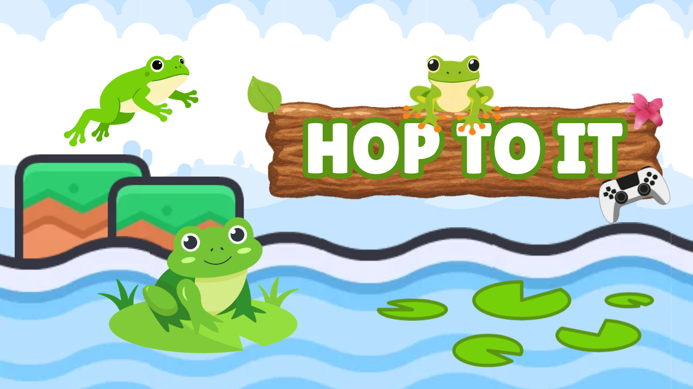

# Hop-To-It! 🐸

A cute frog centered 2D platformer, made by ***The Frog Squad***

## Meet the TEAM!

Programming Lead: **Jesse Chung** 
Narrative Design: **Wyatt Berson** 
Game Feel Developer: **Oliwia Glowczynska** 

### 🎮 Controls

Move Left : A/Left Arrow 
Move Right : D/Right Arrow 
Swim Up : W/Up Arrow 
Swim Down : S/Down Arrow 
Jump : Space (Hold to Jump Higher) 

### 📸 Camera Behavior 

The camera is locked to the player character, keeping them center screen with the exception
that should the player character be too close to outside the map, the camera will stop
on the border to prevent the player from observing things outside of the map.

### ⚙️ Running Instructions

**Play Online**: [LIVE DEMO](https://glovolivia.github.io/Hop-To-It/)

#### Play locally
1. Download and extract project files
2. Open Terminal and navigate to project directory
3. Run: python3 -m http.server 8000
4. Open http://localhost:8000 in your browser.
5. Upon startup, selecting "Start" will bring you to a level selector screen

### 🐸 Features

- Rock Hopper (Wyatt Berson): Teleporter (Move through the tunnel to appear elsewhere in the level)
- Hop King (Jesse Chung): Slippery Ice (The white-topped stone platforms are slippery)
- Flow State (Oliwia Glowczynska): Lever Mechanism (Flip the lever to access previously blocked location)

### ✨ Additional Elements

 - Underwater swimming movement: The player character (frog) has seperate movement when within water

## 🌿 Credits & Attributions

### 🌿 Art

- Kenny: https://kenney.nl/assets

### 🎵 Audio

- OpenGameArt: https://opengameart.org/

